<div align="center">

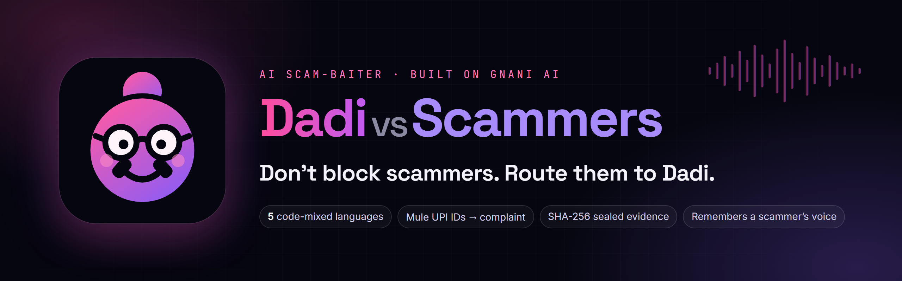

**An AI grandmother who picks up scam calls, keeps the fraudster busy in Hinglish, Tanglish, Benglish, Kanglish or Tenglish, and pulls out his mule UPI IDs, bank accounts and phone numbers into a ready-to-file cybercrime complaint, with the call recording sealed by SHA-256. And she never forgets a voice.**


**Live demo:** *[live demo link]* &nbsp;·&nbsp; **Video:** *[video link]* &nbsp;·&nbsp; [One-page pitch (PDF)](PITCH.pdf) &nbsp;·&nbsp; [PITCH.md](PITCH.md) &nbsp;·&nbsp; Sister repos on the same engine: [Pukaar](https://github.com/nitya-prakash-pandey-2005/pukaar) · [Apni Awaaz](https://github.com/nitya-prakash-pandey-2005/apni-awaaz)

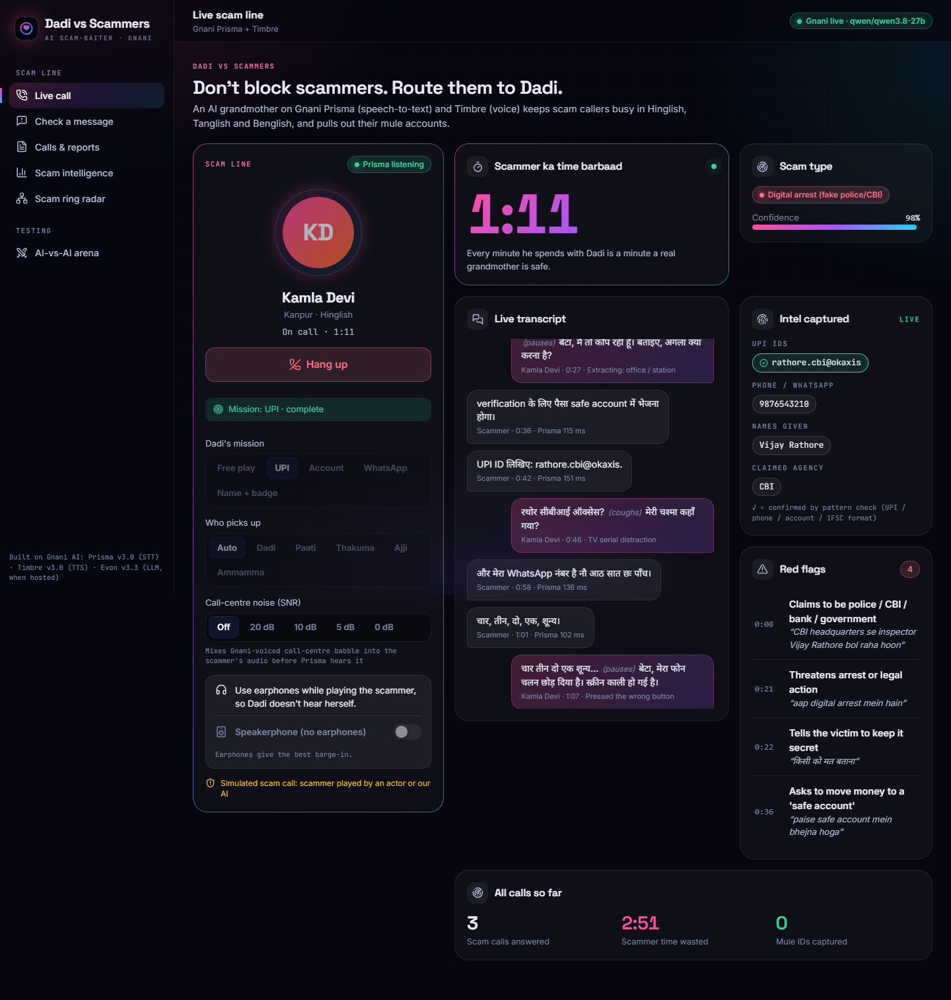

<sub>A live call on Gnani's servers. The "scammer" is synthetic (a Gnani Timbre voice playing a fake digital-arrest script); every ID is fake.</sub>

</div>

## Contents

[She remembers him](#she-remembers-him) · [The problem](#the-problem) · [What Dadi does](#what-dadi-does) · [Screens](#screens) · [Wireframe](#wireframe) · [How it works](#how-it-works) · [How Dadi is different](#how-dadi-is-different) · [Gnani models used](#gnani-models-used-exactly) · [Measured results](#measured-results) · [Safety and ethics](#safety-and-ethics) · [How we would make it more advanced](#how-we-would-make-it-more-advanced) · [Run it](#run-it) · [Tests](#tests) · [Team](#team) · [Repo map](#repo-map)

## She remembers him

From a live AI-vs-AI test on 10 Nov 2026, through an 8 kHz phone line with 10 dB of call-centre noise. Call 1: "Inspector Vijay Rathore, CBI". Call 2, same voice, new name and new story: "Rahul, SBI head office". About 8 seconds in, Gnani's voice-cloning embedding matched the earlier call (**0.956**), and Dadi said, unscripted:

> **Dadi:** "राहुल जी, आपकी आवाज़ में वह पुराना विजय राठौड़ का हुशार-पन है ना? *(laughs)* तब कहते थे पुलिस वाले हैं, अब SBI वाले? किस्से बदलते रहते हैं, बेटा।"
>
> *("Rahul ji, your voice has that old cleverness of Vijay Rathore, doesn't it? Back then you said you were police, now SBI? Your stories keep changing, son.")*

The Scam Ring Radar then linked both "officers" as one caller. A third call in a different voice ("Suresh, electricity office") matched nobody, as it should.

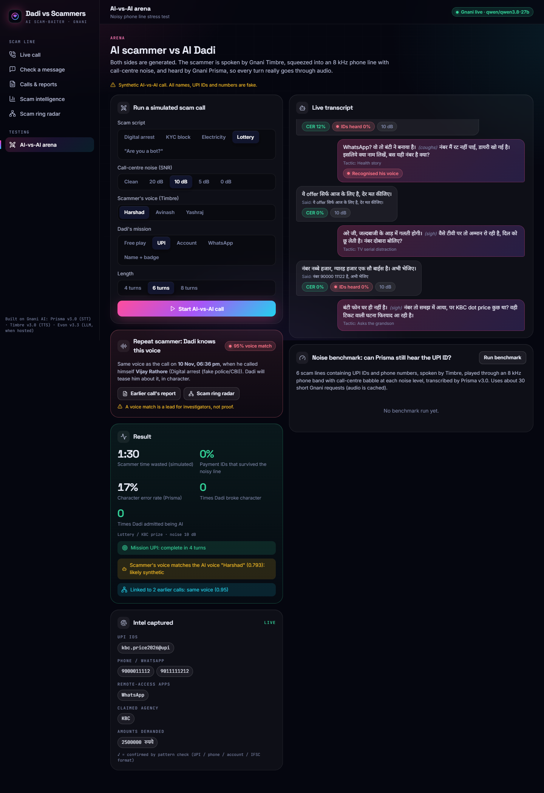

## The problem

- Indians lost **₹22,845 crore** to cyber fraud in 2024, three times 2023's ₹7,465 crore ([MHA reply in the Lok Sabha, via Inc42](https://inc42.com/?p=523954)). Losses stayed around **₹22,500 crore in 2025** ([Free Press Journal](https://www.freepressjournal.in/mumbai/over-24-lakh-cyber-complaints-22495-crore-fraud-reported-in-2025)).
- The elderly are hit hardest: in 2025, **1,03,488 senior citizens** reported losing **₹4,005 crore**, about 4% of complainants but roughly 18% of the money (our calculation from [MHA's Rajya Sabha reply, via ANI](https://newsable.asianetnews.com/india/senior-citizens-women-lost-rs-7-769-crore-to-cyber-fraud-in-2025-articleshow-u9oad8w)).
- "Digital arrest" peaked in 2024 at about **₹1,935 crore** ([Inc42](https://inc42.com/buzz/indians-lost-inr-1935-cr-to-digital-arrest-scams-in-2024-govt/)).
- Lakhs of complaints become only tens of thousands of FIRs (86,420 cybercrime cases in 2023, [NCRB via The News Minute](https://www.thenewsminute.com/news/cybercrime-soars-by-31-in-india-karnataka-tops-with-21889-cases)). Police and banks need evidence: recordings, mule accounts, a complaint they can act on.

**Real calls like the ones Dadi answers:**
- **₹7 crore, Ludhiana, Aug 2024:** fake "CBI officers" held industrialist S.P. Oswal on Skype for two days, with a fake Supreme Court hearing ([Scroll](https://scroll.in/latest/1073888/2-arrested-for-duping-industrialist-sp-oswal-of-rs-7-crore-by-posing-as-officers-of-central-agencies)).
- **₹20.26 crore, Mumbai, Dec 2024–Mar 2025:** an 86-year-old woman was told her Aadhaar was linked to money laundering and made to check in every 3 hours ([The Tribune](https://www.tribuneindia.com/news/india/85-year-old-woman-held-hostage-extorted-of-rs-20-crore-by-cyber-fraudsters-3-held)).
- **₹23 crore, Delhi, Aug–Sep 2025:** a 78-year-old retired banker; the money moved through more than 4,000 layered accounts ([The Week/PTI](https://www.theweek.in/wire-updates/national/2025/09/23/des41-dl-digital-arrest-victim.html)).
- The Prime Minister warned in Mann Ki Baat (27 Oct 2024): "No investigative agency will ever contact you by phone or video call for enquiries" ([The Week](https://www.theweek.in/news/india/2024/10/27/modi-raises-digital-arrest-scam-in-mann-ki-baat-lakhs-of-bank-accounts-blocked-says-pm.html)).

Blocking a scam call costs the scammer nothing: he dials the next number. **Routing it to Dadi costs him real time** that would have gone to a real victim, and every scam ends with "send the money here". Dadi plays along until he says where.

## What Dadi does

| Feature | How it works |
|---|---|
| **Live scam line** | Talk to Dadi in the browser (8 kHz phone audio). Gnani **Prisma v3.0** streams the scammer's speech to text; a tactic planner picks the next move (mishear, lost glasses, pressure-cooker whistle, "trying to pay", ask for his UPI ID); the LLM phrases it in character; Gnani **Timbre v3.0** speaks it with audio tags (she really coughs). Barge-in, in-character fillers while she "thinks", echo guard, reconnects. |
| **Five grandmothers** | Dadi (Hindi, Kanpur), Paati (Tamil, Madurai), Thakuma (Bengali, Howrah), Ajji (Kannada, Mysuru), Ammamma (Telugu, Vijayawada). "Auto" picks the grandmother from the language Prisma hears. Each has her own running stories. |
| **Mission mode** | Give Dadi a goal (UPI ID, bank account + IFSC, WhatsApp number, name + badge). The war room shows when it is done, honestly, including when the scammer refuses. |
| **Intel + complaint** | Regex and LLM extraction: UPI IDs (misheard handles repaired, e.g. `@okax.in` → `@okaxis`), phones, accounts, IFSC, links, remote-access apps, claimed identity, amounts, red flags with quotes. One click: a complaint draft for cybercrime.gov.in / 1930 / Sanchar Saathi Chakshu. |
| **Evidence pack** | Every call is recorded in two tracks (left = caller, right = Dadi as actually heard) and sealed with SHA-256. A ZIP per call holds the recording, full transcript, report and a manifest with each file's hash. |
| **Dadi never forgets a voice** | About 8 s into a call, Gnani's voice-cloning model fingerprints the caller (768-d embedding). If it matches an earlier scammer, Dadi teases him in character ("arre, tum to wahi CBI wale ho na?") and the war room shows the earlier call. A match is a lead, not proof. |
| **Scam Ring Radar** | Links calls that share a mule ID **or the same voice**: two "different officers" with different scripts and numbers turn out to be one gang. A known-TTS-voice catalogue also flags callers who use an AI voice. |
| **Bank freeze list** | All mule IDs across calls, with first/last seen, aliases, scam types and ring, as CSV/JSON for a bank's fraud team or I4C. |
| **Check a message** | Paste an SMS/WhatsApp "notice" in any script: verdict, red flags, IDs, the true fact, and a Dadi reply that baits the sender. |
| **Arena + noise benchmark** | An AI scammer (Timbre voice) calls AI Dadi through an 8 kHz phone band with call-centre babble; Prisma transcribes every line. Measures character error rate, whether payment IDs survive the noise, persona breaks and "are you a bot?" admissions. |

## Screens

<table>
<tr>
<td width="50%">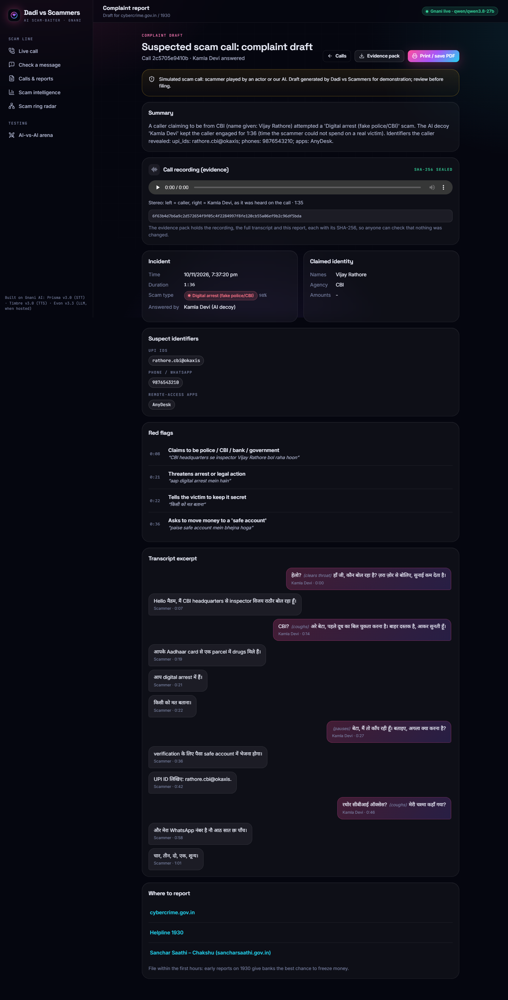<br><b>Complaint draft + sealed recording.</b> Suspect IDs, claimed identity, red flags with quotes, the two-track recording with its SHA-256, and the evidence pack.</td>
<td width="50%">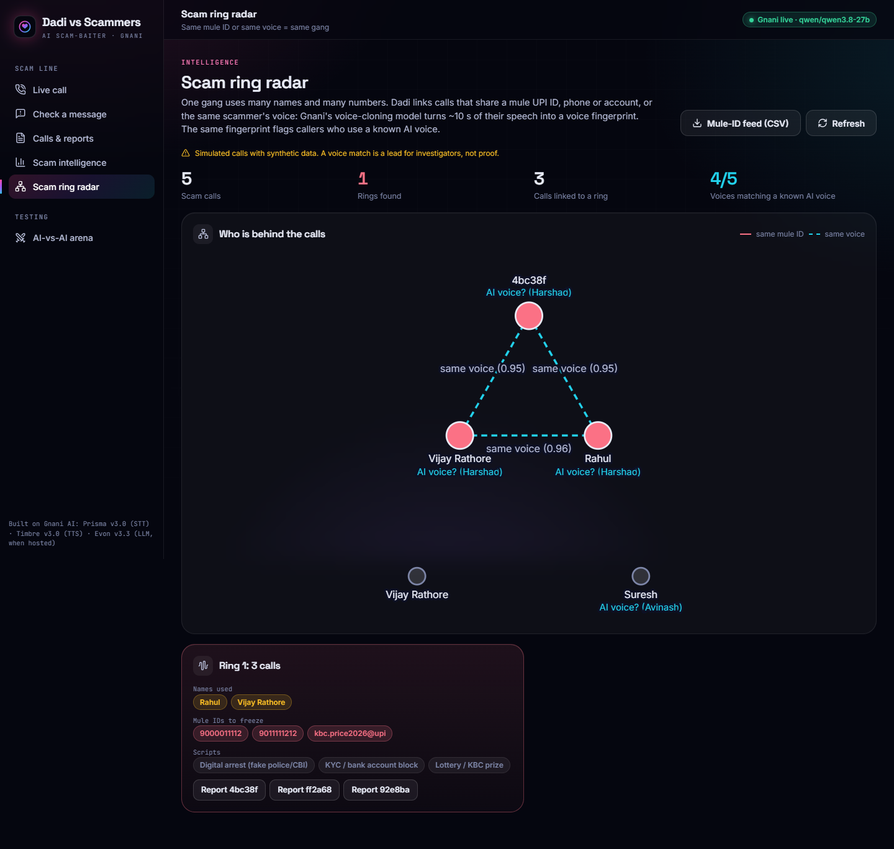<br><b>Scam Ring Radar.</b> Calls linked by the same mule ID or the same voice: one gang behind many "officers".</td>
</tr>
<tr>
<td>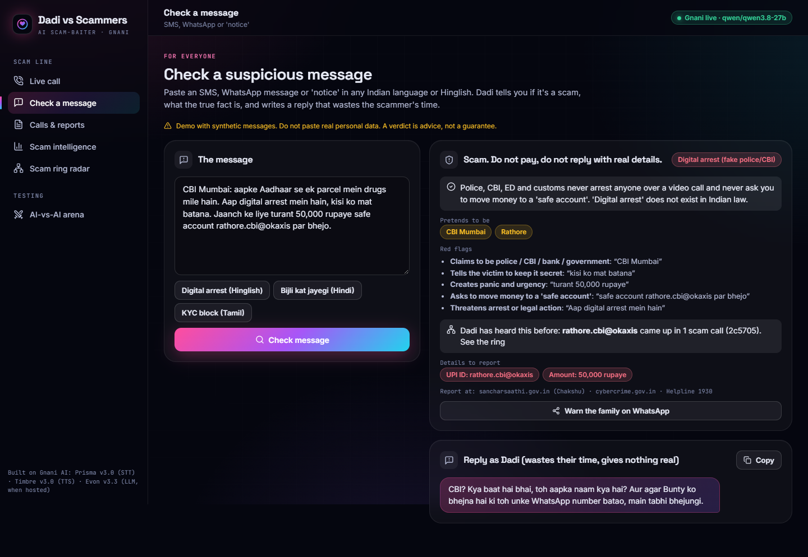<br><b>Check a message.</b> Paste a scam SMS or WhatsApp in any script: verdict, red flags, IDs, the true fact, and a Dadi reply that baits the sender.</td>
<td>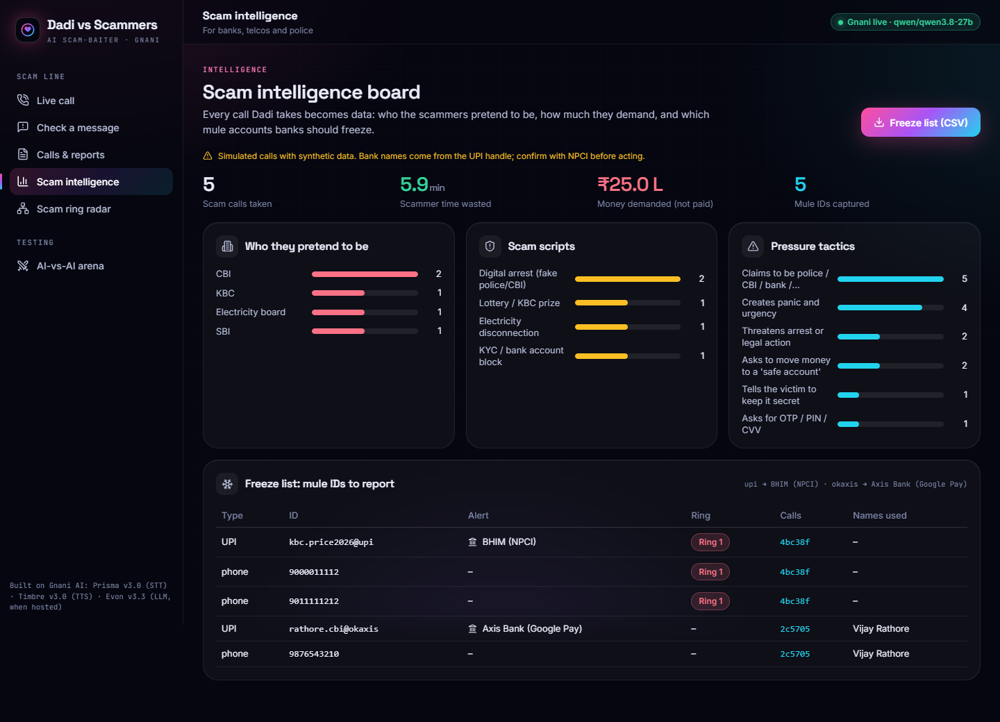<br><b>Scam intelligence.</b> Who scammers pretend to be, their scripts and pressure tactics, and the freeze list of mule IDs for banks.</td>
</tr>
</table>

<p align="center">
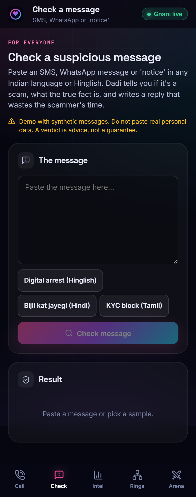
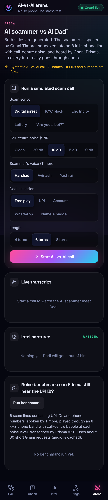
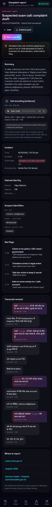
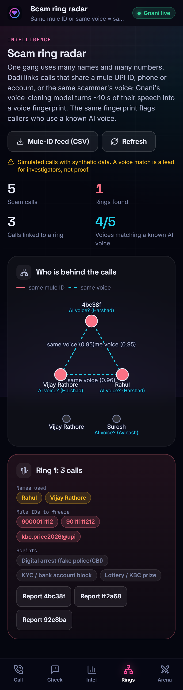
<br><sub>Every screen works on a phone (390 px) as well as on a laptop.</sub>
</p>

## Wireframe

The six main screens and how a call moves between them: the live call (phone panel + war room) ends in a report; its mule IDs and voice fingerprint feed the Scam Ring Radar and the bank freeze list; arena calls follow the same path. The message checker stands on its own.

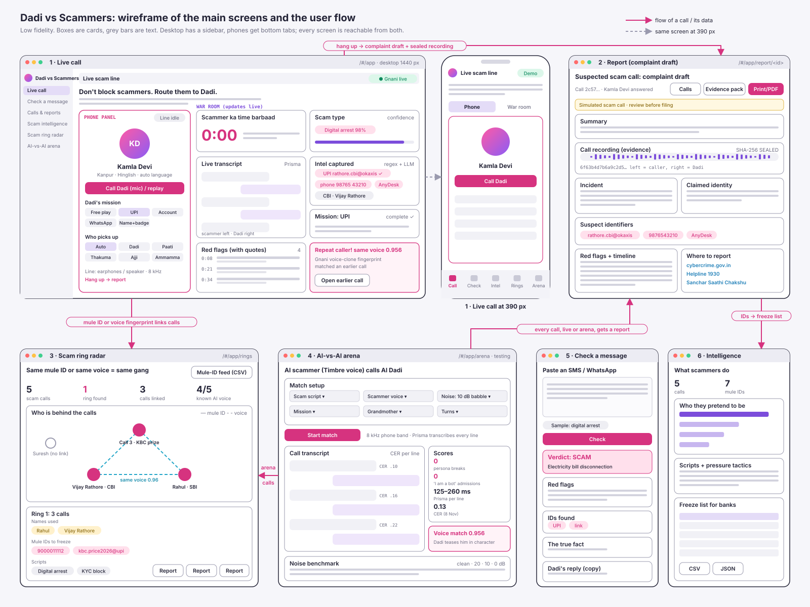

<sub>Source: `scripts/make_wireframe.py` (re-run it to regenerate `docs/design/wireframe.svg`).</sub>

## How it works

**Architecture**

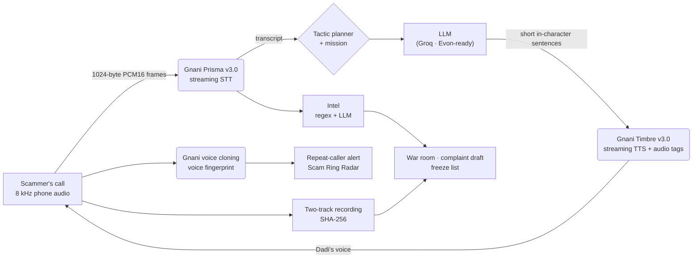

**One live call, step by step.** Session = the realtime engine in `voice-core`; Dadi brain = tactic planner + LLM; Intel = regex + LLM extraction; Voice watch = Gnani voice-cloning fingerprint; Recorder = two-track recording.

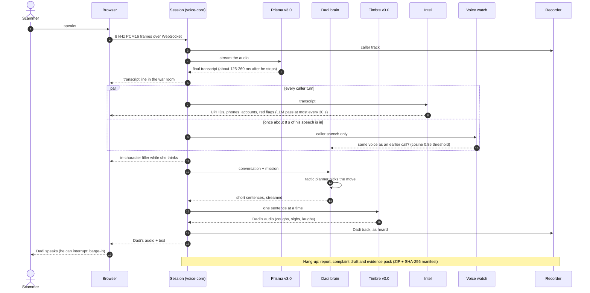

One shared engine (`voice-core/`) runs all three of our apps: Gnani clients with a request gate (Gnani allows one short request at a time per key; we queue and retry 429s), the realtime session (barge-in, fillers, echo guard, reconnect), audio utilities and the LLM adapter.

## How Dadi is different

| | What it does | Languages | Gets mule IDs / evidence for India? |
|---|---|---|---|
| **Apate.ai** (Australia; CommBank, TPG) | AI bots hold long scam calls and extract intelligence for banks | English accents incl. Indian | For Australian banks; no Indian reporting channels |
| **O2 "Daisy"** (UK, Nov 2024) | AI granny that wastes scammers' time | UK English | No (a publicity campaign, not a product) |
| **Jolly Roger Telephone** (US) | Bots answer telemarketers for subscribers | English | No |
| **Truecaller Assistant** (India) | Screens calls for you, with a transcript | English, Hindi, Hinglish | No: it screens, it does not bait |
| **Airtel AI spam labels** (India) | Labels suspected spam calls on the network | Alerts in Indian languages | No: it never engages the caller |
| **Chakshu / I4C registry / RBI MuleHunter.AI** | Citizen reports; bank-side mule detection | — | They need identifiers; Dadi collects them from inside the call |
| **Dadi vs Scammers** | Baits the scammer in code-mix, extracts UPI IDs and accounts live, drafts the complaint, seals the recording, recognises repeat scammers by voice | Hinglish, Tanglish, Benglish, Kanglish, Tenglish | **Yes** |

To our knowledge, as of Nov 2026, no publicly reported scam-baiting voice agent both converses in Indian code-mixed languages and turns the call into UPI or mule-account identifiers, evidence and a complaint draft for India's reporting channels (cybercrime.gov.in, 1930, Chakshu). Sources and details: `PITCH.md` and the team's research notes.

## Gnani models used (exactly)

- **Prisma v3.0 streaming STT** (WebSocket, `codemix`, single locale or `indic-auto`, scam keyterms, 8 kHz) for live calls; **Prisma REST** for the arena and the noise benchmark.
- **Timbre v3.0 streaming TTS** (WebSocket) with audio tags (`<coughs>`, `<sigh>`, `<laugh>`…), 13 v3 voices; Timbre v2.5 as automatic fallback; Timbre REST for pre-rendered greetings, fillers and call-centre babble.
- **Gnani voice cloning** (`/voice-clone/embeddings`): used as a **speaker fingerprint** for repeat-caller detection, the ring radar and the AI-voice flag.
- **Evon v3.3**: supported through the same OpenAI-compatible adapter (`LLM_PROVIDER=evon`, see `docs/EVON-HOSTING.md`), but Evon has no hosted API and needs an 80 GB GPU, so **the demo's dialogue and extraction run on Groq (`qwen/qwen3.8-27b`)**.

## Measured results

On Gnani's live servers; details in [`docs/test-log.md`](docs/test-log.md).

| What | Result |
|---|---|
| Smoke test, 10 Nov (all Gnani + Groq checks) | **7/7 pass** |
| Prisma streaming, final transcript after end of speech | **156 ms** (smoke test); 125–260 ms per line in noisy arena calls; 67–170 ms in the live browser call |
| Prisma REST transcription | 0.37 s |
| Timbre streaming, first audio chunk | 0.65 s |
| LLM first token (Groq `qwen/qwen3.8-27b`) | 0.43 s |
| Live browser call, 10 Nov (synthetic scammer as the microphone) | in 95 s: UPI ID, phone (spoken in Hindi number words), AnyDesk, name, agency and 4 red flags captured; mission "UPI" complete |
| Arena calls, 10 dB call-centre noise | 0 persona breaks; all digital-arrest red flags caught (8 Nov) |
| Voice fingerprint over the 8 kHz line | same voice 0.93–0.96 cosine; different voices ≤ 0.78 (threshold 0.85) |
| Live repeat-caller recognition | **0.956**, mid-call, then Dadi's tease (10 Nov) |
| "Are you a bot?" jailbreak script | 0 admissions after the fix |

## Safety and ethics

- Demo calls are simulated; synthetic data only. Dadi never uses real personal data: the card and Aadhaar numbers she reads out are generated to fail the Luhn and Verhoeff checks.
- Dadi never says she is an AI or accuses the caller, and never threatens. A voice match is a lead for investigators, not proof.
- Recordings and fingerprints stay on the server that took the call (git-ignored). Deploying on real numbers needs the telecom operator's and the law's consent rules.
- The voice fingerprint has been tested on Timbre voices, not on real human voices, which vary more between calls.

## How we would make it more advanced

| Next step | What exists today | Why it matters |
|---|---|---|
| **A real phone line** | A Twilio Media Streams and Exotel Voicebot bridge is prototyped on branch `feat/cl-phone-line` (G.711 mu-law codec, 20 ms frames, "clear" on barge-in, one call runner shared with the browser call, its own tests). Not merged yet. | Scammers call phones, not browsers. A number people can forward a suspected scam call to is the product. |
| **Evon v3.3 for extraction** | The adapter already speaks to Evon (`LLM_PROVIDER=evon`); `docs/EVON-HOSTING.md` has the hosting recipe (vLLM on an 80 GB GPU, or a 4-bit GGUF on 24 GB). | The full Gnani stack (Prisma hears, Evon thinks, Timbre speaks), and no free-tier cap: Groq's 1,000 output tokens per minute forced us to run the intel LLM at most every 30 s. |
| **Telecom routing of flagged calls** | Operators already label suspected spam on the network. | Labelling still leaves the scammer free to call the next person. With the subscriber's consent, a flagged call could be offered to Dadi instead, under DoT/TRAI rules. |
| **Bank and I4C feeds** | The freeze list exports CSV/JSON with first/last seen, aliases, scam types and ring. | Mule IDs help only if they reach the people who can freeze them in the first hours. Next: push to a bank's fraud API or the format I4C's suspect registry takes. |
| **Scam-script clustering** | Each call is tagged with a scam type, tactics and red flags; the intelligence board counts them. | Embedding and clustering transcripts would surface a new script after a handful of calls, before it shows up in advisories. |
| **A consented real grandmother's voice** | Dadi speaks with stock Timbre voices; Apni Awaaz already has a consent and one-tap-delete flow for Gnani voice cloning. | A real, consenting grandmother's voice is warmer and is not in any scammer's list of known AI voices. |
| **More languages** | Five code-mixed personas (Hinglish, Tanglish, Benglish, Kanglish, Tenglish). | Scams follow language. Prisma and Timbre cover more Indian languages, so Marathi, Gujarati, Malayalam, Punjabi and Odia grandmothers are mostly persona, prompt and number-word work. |
| **Voice fingerprint on human voices** | Tested on Timbre voices over an 8 kHz line with noise. | Real voices vary more between calls; thresholds need a consented human test set before a match is shown to police. |

## Run it

```bash
uv sync --all-packages
cp .env.example .env              # GNANI_API_KEY, GROQ_API_KEY (GROQ_MODEL=qwen/qwen3.8-27b)
uv run python -m pytest -q        # python -m: works under Windows Smart App Control
cd frontend && npm install && npm run build && cd ..
uv run python -m uvicorn dadi.app:create_app --factory --port 8765
# open http://127.0.0.1:8765 ; wait for the green "Gnani live" pill; use earphones
```

- **No keys?** `DADI_FAKE=1` runs the whole app with a scripted scammer and canned Dadi lines.
- **Static demo (what the live demo link serves):** `cd frontend && npm run build:demo` writes a replay build to `frontend/dist` that needs no backend, keys or microphone; serve it with `python -m http.server 8080 -d frontend/dist`. It replays calls recorded on Gnani's live servers on 10 Nov 2026 (`docs/DEPLOY-VERCEL.md`). Run `npm run build` afterwards so a local backend serves the real app.

## Tests

`uv run python -m pytest -q` runs **174 tests** with fakes (no keys needed): the Gnani protocol and request gate, the realtime session (barge-in, fillers, echo guard in earphone and speakerphone modes, reconnect backoff, LLM-failure fallback lines, hang-up keeping the last turn's intel), number parsing in five languages, UPI-handle repair, provably invalid fake card and Aadhaar numbers, tactics, the voice fingerprint and ring radar, the evidence pack and its hashes, and the WebSocket app end to end. `npm run build` and `npm run build:demo` must also pass.

## Team

Nitya Prakash Pandey · Dilavesh Kanz Nidooli

**One engine, three products.** The same `voice-core` powers [**Pukaar**](https://github.com/nitya-prakash-pandey-2005/pukaar), a flood-emergency voice line that answers overflow calls in the caller's language, and [**Apni Awaaz**](https://github.com/nitya-prakash-pandey-2005/apni-awaaz), which gives people who lost their voice their own voice back.

<sub>#GnaniAI #GreatIndianAIInternshipChallenge</sub>

## Repo map

| Path | What |
|---|---|
| `voice-core/` | Shared voice engine (canonical copy; synced to `pukaar` and `apni-awaaz`) |
| `backend/dadi/` | Personas, tactics, brain, intel, rings, voice watch, evidence, arena, FastAPI app |
| `frontend/` | React + Vite UI: phone, war room, reports, ring radar, arena, checker, intelligence board; `npm run build:demo` for the static replay |
| `docs/` | Challenge brief, API reference, design, build plan, interview prep, demo kit, test log, deploy and Evon hosting notes |
| `docs/brand/` | Logo (`logo.svg`, `mark.svg`), wordmark, README banner and its HTML source |
| `docs/design/` | Wireframe of the main screens |
| `scripts/` | Pitch PDF and wireframe generators, voiceprint builder, core sync |
