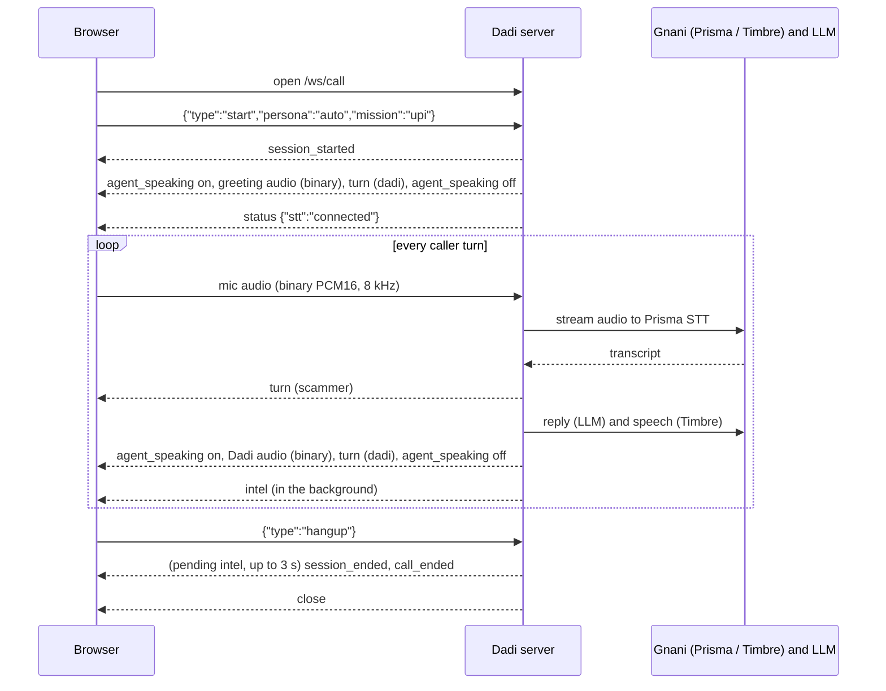

# Dadi vs Scammers: API reference

This is the reference for the Dadi backend (`backend/dadi/app.py`, built by `create_app()`): the REST routes the
web app uses and the two WebSocket protocols, `/ws/call` (a live scam call) and `/ws/arena` (AI scammer vs AI Dadi,
plus the noise benchmark). Everything here comes from the code. If the code and this page ever disagree, the code
is right; please fix the page.

- **Machine-readable REST schema:** `docs/api/openapi.json`, generated in-process and without keys by
  `uv run python scripts/export_openapi.py`. A running server also serves it at `/openapi.json`, with Swagger UI at
  `/docs`. Most handlers return plain dicts, so the OpenAPI file lists the routes and parameters but not the response
  shapes. This page documents those shapes.
- **WebSockets** are documented only on this page, because OpenAPI does not describe WebSocket protocols.

## Basics

| Item | Value |
|---|---|
| Start the server | `uv run uvicorn dadi.app:create_app --factory --host 127.0.0.1 --port 8765` (or `run_backend.ps1` / `run_backend.sh`) |
| Base URL (local) | `http://127.0.0.1:8765` (REST), `ws://127.0.0.1:8765` (WebSockets) |
| Authentication | None. The server is meant to run on a trusted machine or behind your own gateway. API keys (Gnani, Groq) stay on the server in `.env` and never reach the browser. |
| Web app | When `frontend/dist` exists, `/` serves the built web app (static files, `index.html` fallback). API routes are matched first. |
| Fake mode | `DADI_FAKE=1` runs everything with no keys and no network: a scripted scammer, canned Dadi lines, a soft 220 Hz tone instead of speech, and a fixed fake voiceprint. It uses a separate database, `cache/dadi_fake.db` (the real one is `cache/dadi.db`). |

### Conventions

- Bodies and messages are JSON objects. Times called `started_at`, `ended_at`, `first_seen`, `last_seen` and
  `generated_at` are Unix seconds (float). Times called `t` are seconds since the start of the call. Report times are
  ISO 8601 in UTC.
- Call IDs are 12 lower-case hex characters (for example `2c5705e9410b`).
- Errors use FastAPI's shape: `{"detail": "call not found"}` with the HTTP status code. A request body that is not a
  JSON object gets FastAPI's standard `422` validation error.
- An `intel` object (used by several routes and messages) always has these keys:

```json
{
  "upi_ids": ["rathore.cbi@okaxis"], "phones": ["9876543210"], "accounts": [], "ifsc": [], "urls": [],
  "apps": ["AnyDesk"], "amounts": ["50,000 rupaye"], "names": ["Vijay Rathore"], "agencies_claimed": ["CBI"],
  "scam_type": "digital_arrest", "scam_confidence": 0.98,
  "red_flags": [{"flag": "threat_of_arrest", "quote": "Aap digital arrest mein hain", "t": 12.4}],
  "validated": {"upi_ids": ["rathore.cbi@okaxis"], "phones": ["9876543210"]}
}
```

`scam_type` is one of the keys in `backend/dadi/taxonomy.py` (or `"other"`), `red_flags[].flag` is one of its red
flag keys, and `validated` lists the identifiers that the deterministic regex rules confirmed.

## REST routes

| Method | Path | Purpose |
|---|---|---|
| GET | `/api/health` | Keys present, model names, readiness |
| GET | `/api/personas` | The five grandmother personas |
| GET | `/api/missions` | Operator missions for a call |
| GET | `/api/totals` | Calls, seconds wasted, distinct mule IDs |
| GET | `/api/calls` | The 50 most recent calls |
| GET | `/api/calls/{call_id}` | One call with its full transcript |
| GET | `/api/calls/{call_id}/report` | Complaint draft (cybercrime.gov.in / 1930 / Chakshu) |
| GET | `/api/calls/{call_id}/audio` | Two-track call recording (WAV) |
| GET | `/api/calls/{call_id}/evidence.zip` | Evidence pack with SHA-256 manifest |
| GET | `/api/feed/mule-ids.json` | Mule-ID feed across all calls (JSON) |
| GET | `/api/feed/mule-ids.csv` | Mule-ID feed across all calls (CSV) |
| GET | `/api/rings` | Scam Ring Radar graph (shared IDs and voices) |
| POST | `/api/check` | Scam Message Checker for a pasted SMS / WhatsApp text |
| GET | `/api/insights` | Intelligence board aggregates |
| GET | `/api/freeze-list` | One row per mule ID, for bank alerts (JSON or CSV) |

### GET /api/health

Reports configuration and readiness. It makes no network request: `llm_ready` and `llm_last_error` come from the
outcome of the most recent LLM call made by this process.

```json
{
  "gnani_key": true,
  "llm_key": true,
  "llm_provider": "groq",
  "groq_model": "qwen/qwen3.8-27b",
  "llm_model": "qwen/qwen3.8-27b",
  "llm_ready": true,
  "llm_last_error": null,
  "intel_llm_provider": "groq",
  "stt_mode": "stream",
  "fillers_ready": true,
  "fake": false
}
```

- `llm_key` is true when a Groq key or an Evon base URL is configured. `llm_model` is `"fake"` in fake mode.
- `fillers_ready` turns true once the pre-rendered greeting and filler clips and the background babble are loaded
  (immediately in fake mode).
- `stt_mode` is `"stream"` (Prisma streaming) or `"turn"` (one REST transcription per caller turn).

### GET /api/personas

```json
[
  {"key": "dadi", "name": "Kamla Devi", "age": 74, "city": "Kanpur", "language": "hi-IN", "voice": "Lakshmi"},
  {"key": "paati", "name": "Meenakshi", "age": 76, "city": "Madurai", "language": "ta-IN", "voice": "Vasudha"}
]
```

The keys are `dadi` (Hindi), `paati` (Tamil), `thakuma` (Bengali), `ajji` (Kannada) and `ammamma` (Telugu). `voice` is
the Gnani Timbre voice the persona speaks with.

### GET /api/missions

```json
[
  {"key": "upi", "label": "Get the UPI ID"},
  {"key": "account", "label": "Get the bank account + IFSC"},
  {"key": "whatsapp", "label": "Get the WhatsApp number"},
  {"key": "identity", "label": "Get name, badge and office"}
]
```

A mission is an optional goal set when a call starts: Dadi steers towards it, and the call reports when it is done.

### GET /api/totals

```json
{"calls": 5, "seconds_wasted": 356.06, "mule_ids": 5}
```

`mule_ids` counts distinct UPI IDs, phone numbers and bank accounts (case-insensitive) across all calls.

### GET /api/calls

The 50 most recent calls, newest first, without transcripts.

```json
[
  {
    "id": "4bc38fb2b5f2",
    "persona": "dadi",
    "started_at": 1794319963.25,
    "ended_at": 1794319992.24,
    "wasted_seconds": 89.7,
    "intel": {"upi_ids": ["kbc.price2026@upi"], "scam_type": "lottery_prize", "...": "full intel object"}
  }
]
```

`ended_at` is `null` while a call is still running.

### GET /api/calls/{call_id}

The same object as in `/api/calls`, plus `turns`, in the order they were said:

```json
{
  "id": "2c5705e9410b", "persona": "dadi", "started_at": 1794319640.78, "ended_at": 1794319736.98,
  "wasted_seconds": 95.3, "intel": {"...": "full intel object"},
  "turns": [
    {"speaker": "dadi", "text": "Hello? Haan ji, kaun bol raha hai?", "t": 0.0, "lang": null, "latency_ms": null},
    {"speaker": "scammer", "text": "Hello madam, main CBI headquarters se Inspector Vijay Rathore bol raha hoon.",
     "t": 7.47, "lang": "hi-IN", "latency_ms": 170.0}
  ]
}
```

`speaker` is `"scammer"` or `"dadi"`. `lang` and `latency_ms` (speech-to-text latency) are set on the scammer's
turns only. Errors: `404 {"detail": "call not found"}`.

### GET /api/calls/{call_id}/report

A complaint draft built from the stored call (`backend/dadi/report.py`).

```json
{
  "title": "Suspected scam call: complaint draft",
  "disclaimer": "Simulated scam call: scammer played by an actor or our AI. Draft generated by Dadi vs Scammers for demonstration; review before filing.",
  "call_id": "2c5705e9410b",
  "persona": "Kamla Devi",
  "summary": "A caller claiming to be from CBI (name given: Vijay Rathore) attempted a 'Digital arrest (fake police/CBI)' scam. ...",
  "incident_time": "2026-11-10T14:07:20.776887+00:00",
  "duration_seconds": 96.2,
  "scam_type": "digital_arrest",
  "scam_type_label": "Digital arrest (fake police/CBI)",
  "scam_confidence": 0.98,
  "claimed_identity": {"names": ["Vijay Rathore"], "agencies": ["CBI"]},
  "suspect_identifiers": {"upi_ids": ["rathore.cbi@okaxis"], "phones": ["9876543210"], "apps": ["AnyDesk"]},
  "amounts_demanded": [],
  "red_flags": [{"flag": "threat_of_arrest", "label": "Threatens arrest or legal action", "quote": "Aap digital arrest mein hain", "t": 12.4}],
  "transcript_excerpt": [{"speaker": "dadi", "text": "...", "t": 0.0}],
  "where_to_report": ["cybercrime.gov.in", "Helpline 1930", "Sanchar Saathi – Chakshu (sancharsaathi.gov.in)"],
  "chakshu": {
    "medium": "Call",
    "category": "Impersonation as Government official / Police",
    "date_time": "2026-11-10T14:07:20.776887+00:00",
    "description": "A caller claiming to be from CBI ..."
  },
  "recording": {
    "sha256": "6f63b4d7...", "bytes": 3078444, "seconds": 96.2,
    "channels": {"left": "caller", "right": "dadi"}, "url": "/api/calls/2c5705e9410b/audio"
  }
}
```

- `suspect_identifiers` only contains the non-empty identifier lists (`upi_ids`, `phones`, `accounts`, `ifsc`, `urls`,
  `apps`).
- `transcript_excerpt` is the first 12 turns. `red_flags` are sorted by time.
- `chakshu.category` is a suggested Sanchar Saathi Chakshu category for the scam type (`"Others"` when there is no
  mapping); `description` is the summary cut to 1,000 characters.
- `recording` is `null` when the call has no saved recording or the file is gone. The server-side file path is never
  returned.

Errors: `404 {"detail": "call not found"}`.

### GET /api/calls/{call_id}/audio

The call recording as `audio/wav`, downloaded as `dadi-call-{call_id}.wav`: 16-bit PCM, stereo, at the server's
sample rate (8 kHz by default). The left channel is the caller as received, the right channel is Dadi as actually
played (cut where a barge-in flushed the caller's player). Both tracks share the call clock. Recordings are capped
at 15 minutes and stored under `cache/recordings/` on the server.

Errors: `404 {"detail": "no recording for this call"}`.

### GET /api/calls/{call_id}/evidence.zip

A ZIP (`application/zip`, downloaded as `dadi-evidence-{call_id}.zip`) with:

| File | Contents |
|---|---|
| `manifest.json` | `call_id`, `generated_at` (ISO), `generator`, `note`, `recording` (the metadata above, or `null`), and `files`: `[{"name", "bytes", "sha256"}]` for every other file in the ZIP |
| `report.json` | The report from `/api/calls/{call_id}/report` |
| `transcript.txt` | The full transcript, one line per turn: `[m:ss] Scammer: ...` / `[m:ss] Dadi: ...` |
| `recording.wav` | The two-track recording, when there is one |

Errors: `404 {"detail": "call not found"}`.

### GET /api/feed/mule-ids.json

Every mule identifier seen across calls (up to the 5,000 most recent), grouped by kind and value, most-seen first. Meant for a bank fraud team or I4C to ingest.

```json
{
  "generated_at": 1794320100.5,
  "note": "Identifiers revealed by suspected scam callers. Leads, not proof.",
  "rows": [
    {
      "kind": "upi_id", "value": "kbc.price2026@upi", "calls": 1, "call_ids": ["4bc38fb2b5f2"],
      "aliases": [], "scam_types": ["lottery_prize"],
      "first_seen": 1794319963.25, "last_seen": 1794319963.25, "ring": 1
    }
  ]
}
```

`kind` is one of `upi_id`, `phone`, `bank_account`, `ifsc`, `url`. `value` is lower-cased. `aliases` are the names
the callers gave. `ring` is the Scam Ring Radar ring number, or `null`.

### GET /api/feed/mule-ids.csv

The same rows as CSV (`text/csv; charset=utf-8`, downloaded as `dadi-mule-ids.csv`). Columns:
`kind,value,calls,first_seen,last_seen,scam_types,aliases,ring,call_ids`. Times are ISO 8601 (UTC), list fields are
joined with `;`, and `ring` is empty when the identifier belongs to no ring.

### GET /api/rings

The Scam Ring Radar graph over the 500 most recent calls. Two calls are linked when they share a UPI ID, phone number
or bank account (`kind: "id"`), or, failing that, when both have a voiceprint and the two voiceprints have a cosine
similarity of at least 0.85 (`kind: "voice"`). Rings are the connected groups of two or more calls, largest first.

```json
{
  "nodes": [
    {"id": "4bc38fb2b5f2", "ring": 1, "voiceprint": true, "synthetic": {"voice": "Harshad", "score": 0.793},
     "names": [], "scam_type": "lottery_prize", "ids": ["9000011112", "9011111212", "kbc.price2026@upi"]}
  ],
  "links": [
    {"source": "4bc38fb2b5f2", "target": "ff2a680e24e0", "kind": "voice", "reason": "same voice (0.95)"}
  ],
  "rings": [
    {"calls": ["4bc38fb2b5f2", "ff2a680e24e0", "92e8ba0a7348"], "aliases": ["Rahul", "Vijay Rathore"],
     "ids": ["9000011112", "9011111212", "kbc.price2026@upi"],
     "scam_types": ["digital_arrest", "kyc_bank_block", "lottery_prize"]}
  ]
}
```

`synthetic` is set when a call's voiceprint clearly matches one of the 13 Gnani Timbre catalogue voices (a catalogue
match, not deepfake detection); otherwise it is `null`.

### POST /api/check

The Scam Message Checker. Request body:

```json
{"text": "CBI Mumbai se bol raha hoon. Aap digital arrest mein hain. Kisi ko mat batana. Turant 50,000 rupaye safe account rathore.cbi@okaxis par bhejo."}
```

`text` is required; only the first 2,000 characters are analysed. Response:

```json
{
  "verdict": "scam",
  "scam_type": "digital_arrest",
  "scam_type_label": "Digital arrest (fake police/CBI)",
  "confidence": 0.98,
  "claimed": ["CBI Mumbai", "Rathore"],
  "red_flags": [{"flag": "demands_secrecy", "label": "Tells the victim to keep it secret", "quote": "kisi ko mat batana"}],
  "identifiers": {"upi_ids": ["rathore.cbi@okaxis"], "amounts": ["50,000 rupaye"]},
  "risky_links": [],
  "seen_before": [{"id": "rathore.cbi@okaxis", "calls": ["2c5705e9410b"]}],
  "fact": "Police, CBI, ED and customs never arrest anyone over a video call and never ask you to move money to a 'safe account'. 'Digital arrest' does not exist in Indian law.",
  "persona": "dadi",
  "dadi_reply": "Arre wah, digital arrest! ...",
  "report_at": ["sancharsaathi.gov.in (Chakshu)", "cybercrime.gov.in", "Helpline 1930"]
}
```

- `verdict` is `scam`, `suspicious` or `no_signs`. A UPI ID, phone number or account already seen in an earlier
  call (`seen_before`, checked against the 500 most recent calls) makes it `scam`.
- `risky_links`: `[{"url", "reasons": [...]}]` for links that look like phishing (short links, bare IPs, cheap
  domains, a bank or agency name on a non-official site).
- `persona` is chosen from the script of the message (Tamil, Bengali, Kannada, Telugu, else Hindi). `dadi_reply` is a
  short text reply in that persona's voice that baits the sender for payment details; it is empty for `no_signs` or
  when the LLM fails.

Errors: `400 {"detail": "text is required"}` for a missing or blank `text`.

### GET /api/insights

Aggregates over the 500 most recent calls:

```json
{
  "calls": 5,
  "minutes_wasted": 5.9,
  "rupees_demanded": 2500980,
  "agencies": [{"name": "CBI", "calls": 2}, {"name": "KBC", "calls": 1}],
  "scam_types": [{"type": "digital_arrest", "calls": 2}, {"type": "lottery_prize", "calls": 1}],
  "red_flags": [{"flag": "impersonates_authority", "calls": 5}, {"flag": "urgency_pressure", "calls": 4}],
  "handles": [{"handle": "okaxis", "bank": "Axis Bank (Google Pay)", "ids": 1}]
}
```

`agencies` is the top 8 and `red_flags` the top 6. `handles` groups UPI IDs by their handle (the part after `@`) and
names the bank or app behind it when known.

### GET /api/freeze-list

Query parameter `format`: `json` (default) or `csv`. One row per mule ID (UPI, phone, account), ring members first:

```json
[
  {"kind": "UPI", "id": "kbc.price2026@upi", "bank": "BHIM (NPCI)", "calls": ["4bc38fb2b5f2"], "ring": 1,
   "names": [], "first_seen": 1794319963.25}
]
```

`bank` is filled for UPI IDs with a known handle. With `format=csv` the response is `text/csv`, downloaded as
`dadi-freeze-list.csv`, with columns `kind,id,bank,ring,calls,names_used,first_seen_unix` (call IDs separated by
spaces, names by `; `).

## WebSocket `/ws/call`: a live scam call

One WebSocket per call. The browser streams the caller's microphone up, and the server streams Dadi's voice and the
war-room events down.

### Audio frames (binary)

| Direction | Format |
|---|---|
| Client to server | The caller's audio: raw PCM, signed 16-bit little-endian, mono, at the server's sample rate (`SAMPLE_RATE`, default **8000 Hz**). Any frame length works; the web client sends 512-sample frames (64 ms) and drops frames rather than queueing them when the socket has more than 256 KB buffered. |
| Server to client | Dadi's voice in the same format. Chunks arrive faster than real time; the client plays them back to back. Spoken lines arrive as Timbre streams them; a pre-rendered greeting comes in 200 ms chunks; filler and fallback clips come in one piece. In fake mode the audio is a soft 220 Hz tone whose length follows the text. |

### Client to server messages (JSON text frames)

**`start`** (must be the first message):

```json
{"type": "start", "persona": "auto", "mission": "upi", "noise_snr_db": null, "speakerphone": false}
```

| Field | Meaning |
|---|---|
| `persona` | A persona key (`dadi`, `paati`, `thakuma`, `ajji`, `ammamma`) or `"auto"` (the default). Any value that is not a persona key means auto: Dadi starts as `dadi` and switches persona to match the caller's language on his first transcript. |
| `mission` | Optional: `upi`, `account`, `whatsapp` or `identity`. Other values are ignored. |
| `noise_snr_db` | Optional number: mix call-centre babble into the caller's audio at this SNR (dB) before speech-to-text, to demonstrate Prisma on a noisy line. `null` or absent means no added noise. |
| `speakerphone` | Optional boolean. `true` switches the session to half duplex for laptop speakers: the caller's voice activity alone no longer interrupts Dadi, and only a transcript that is not an echo of her own words does. |

**`set_noise`** (any time during the call): `{"type": "set_noise", "snr_db": 10}`. `null` turns the added noise off.

**`hangup`**: `{"type": "hangup"}` ends the call. Closing the socket also ends it.

Other `type` values are ignored. A text frame that is not valid JSON ends the call (the call row, recording and
voiceprint are still saved).

### Server to client messages (JSON text frames)

| `type` | Fields | When |
|---|---|---|
| `session_started` | `started_at`, `call_id`, `persona`, `persona_name`, `city`, `auto` | Once, right after `start` |
| `agent_speaking` | `on` (bool) | `true` when the first audio chunk of a line is sent; `false` when sending it has finished or a barge-in stopped it |
| `turn` | `speaker`, `text`, `t`, plus `lang`, `latency_ms` (scammer) or `tactic`, `phase`, `recognised`, `fallback` (Dadi, when present) | After each caller transcript, and after each of Dadi's lines has been sent |
| `stop_audio` | none | Barge-in: the caller started talking over Dadi. Flush any queued audio at once. |
| `status` | `stt`: `connected`, `reconnecting` or `error`; `message` with `error` | Speech-to-text connection changes |
| `persona` | `persona`, `persona_name`, `city`, `language` | Auto mode only, once: the caller's language picked a different grandmother |
| `intel` | `call_id`, `intel`, `mission` (`{"key", "done"}` or `null`) | After each caller turn, when the analysis finishes |
| `repeat_caller` | `call_id`, `match` | The caller's voice matches an earlier call |
| `session_ended` | `session_seconds` | The session has stopped (after `hangup` or a disconnect) |
| `call_ended` | `call_id`, `wasted_seconds` | Last message; the server then closes the socket |

Examples:

```json
{"type": "session_started", "started_at": 1794319640.78, "call_id": "2c5705e9410b", "persona": "dadi", "persona_name": "Kamla Devi", "city": "Kanpur", "auto": true}
{"type": "turn", "speaker": "scammer", "text": "Hello madam, main CBI headquarters se Inspector Vijay Rathore bol raha hoon.", "t": 7.47, "lang": "hi-IN", "latency_ms": 170}
{"type": "turn", "speaker": "dadi", "text": "CBI? <coughs> Arre beta, pehle doodh ka bill chukta karna hai.", "t": 12.9, "tactic": "door_bell", "phase": "confused"}
{"type": "persona", "persona": "paati", "persona_name": "Meenakshi", "city": "Madurai", "language": "ta-IN"}
{"type": "intel", "call_id": "2c5705e9410b", "intel": {"names": ["Vijay Rathore"], "...": "full intel object"}, "mission": {"key": "upi", "done": false}}
{"type": "repeat_caller", "call_id": "4bc38fb2b5f2", "match": {"call_id": "92e8ba0a7348", "similarity": 0.95, "names": ["Vijay Rathore"], "agencies": ["CBI Mumbai"], "scam_type": "digital_arrest", "ids": [], "started_at": 1794315978.19}}
{"type": "status", "stt": "error", "message": "speech recognition unavailable"}
{"type": "call_ended", "call_id": "2c5705e9410b", "wasted_seconds": 95.3}
```

Notes on the fields:

- While Dadi "thinks" (the caller has stopped and the transcript is being processed), the server may send a short
  pre-rendered filler clip ("haan beta...") as audio only, with no `agent_speaking` or `turn` message.
- `turn.text` for Dadi can contain Timbre sound tags such as `<coughs>` or `<pauses>`; the UI shows or strips them.
  Her greeting turn has only `speaker`, `text` and `t`.
- `turn.tactic` and `turn.phase` name the scam-baiting move Dadi chose (`backend/dadi/tactics.py`).
  `recognised: true` means she knows this caller's voice from an earlier call. `fallback: true` means the reply
  failed or was too slow (the LLM's first sentence must arrive within its timeout) and she said a pre-rendered
  "say that again?" line instead.
- `intel` analysis is coalesced: while one analysis runs, newer turns only mark it out of date, and it runs once more
  on the latest transcript. The regex identifiers run on every turn; the LLM part runs less often to stay within the
  Groq token budget.
- `repeat_caller` needs about 8 seconds of the caller's speech (audio received while Dadi is not speaking) and a
  voiceprint match of at least 0.85 against an earlier call. It needs a Gnani key, or fake mode (where every caller
  has the same fake voice, so the second fake call always matches). `match` has `call_id`, `similarity`, `names`,
  `agencies`, `scam_type` (or `null`), `ids` and `started_at` of the earlier call.
- `status` with `reconnecting` is followed by retries after 0.5, 1, 2, 4 and 8 seconds; `error` means all of them
  failed. The call stays open either way.

### Typical sequence



If the caller talks while Dadi is speaking, the server sends `stop_audio` and `agent_speaking {"on": false}`, and
the client must flush its player.

### Connection and close behaviour

- If the first message is valid JSON but its `type` is not `start`, the server closes the socket with code **1008**
  (policy violation). If the first frame is not JSON at all, the server ends the connection without starting a
  session.
- On `hangup` or a disconnect the server stops Dadi, closes speech-to-text, waits up to 3 seconds for a pending intel
  analysis (the last turn often carries the UPI ID, so `intel` and `turn` messages can still arrive), ends the call,
  then sends `session_ended`, saves the recording, sends `call_ended` and closes the socket normally. After the
  socket is closed it saves the caller's voiceprint (one Gnani request).
- The web client closes the socket itself if `call_ended` has not arrived 8 seconds after it sent `hangup`.
- One bad message or a failing component never loses the call: the call row, the recording and the voiceprint are
  saved in every case.

## WebSocket `/ws/arena`: AI scammer vs AI Dadi, and the noise benchmark

The client opens the socket, sends one request, and then only listens. The server sends events and closes the socket
when the run is done. Closing the socket early stops the run; an arena run that has started is still saved as a call.

Every Gnani request in a run is made strictly one at a time. Each scammer line is spoken by Timbre, squeezed into
an 8 kHz phone band, mixed with babble at the chosen SNR and transcribed by Prisma, so the run really goes through
audio. In fake mode, speech is a tone and "speech-to-text" returns the intended line, so `cer` is 0.

### Client to server: arena request

```json
{"type": "arena", "scam_type": "lottery_prize", "turns": 6, "snr_db": 10, "persona": "dadi", "scammer_voice": "Harshad", "mission": "upi"}
```

| Field | Default | Meaning |
|---|---|---|
| `type` | | Anything other than `"benchmark"` runs the arena. The web app sends `"arena"`. |
| `scam_type` | `digital_arrest` | Scammer script: `digital_arrest`, `bot_test`, `kyc_bank_block`, `electricity_bill` or `lottery_prize`. An unknown value uses the `digital_arrest` script. |
| `turns` | 6 | Number of scammer turns, clamped to 1 to 12. |
| `snr_db` | `null` | Babble noise level in dB; `null` is a clean phone line (band limit only). |
| `persona` | `dadi` | Persona key; an unknown key uses `dadi`. |
| `scammer_voice` | `Harshad` | The Timbre voice the scammer speaks with. |
| `mission` | `null` | `upi`, `account`, `whatsapp` or `identity`; other values are ignored. |

### Client to server: benchmark request

```json
{"type": "benchmark", "snr_list": [null, 20, 10, 5, 0]}
```

Each of the six benchmark lines (`BENCH_LINES` in `backend/dadi/scammer_scripts.py`) is spoken and transcribed once
at each SNR in `snr_list` (default `[null, 20, 10, 5, 0]`, where `null` is a clean line).

### Server to client messages

| `type` | Fields | When |
|---|---|---|
| `arena_turn` (scammer) | `speaker: "scammer"`, `intended`, `text`, `cer`, `entity_recall`, `snr_db`, `latency_ms`, `t` | After each scammer line has gone through the noisy line and Prisma |
| `arena_turn` (dadi) | `speaker: "dadi"`, `text`, `t`, `tactic`, `phase`, `recognised` | After each of Dadi's replies |
| `repeat_caller` | `call_id`, `match` | The scammer's voice matches an earlier call (not in fake mode) |
| `mission` | `mission`, `done: true`, `turn` | Once, when the mission's identifier has been captured |
| `intel` | `intel` | After each round |
| `arena_done` | `summary` | Last message of an arena run |
| `bench_row` | `snr_db`, `line_idx`, `intended`, `heard`, `cer`, `entity_recall`, `latency_ms` | Benchmark: one per line per SNR |
| `bench_done` | `by_snr`: `[{"snr_db", "n", "cer", "entity_recall"}]` | Last message of a benchmark |
| `error` | `message` | The run failed, or the server has no Gnani key (`"GNANI_API_KEY missing in .env"`, outside fake mode) |

- `intended` is what the scammer said and `text` (or `heard`) is what Prisma transcribed. `cer` is the character
  error rate on normalised text (number words become digits, punctuation is ignored), or `null` when the reference
  and transcript are in different scripts (romanised vs Devanagari). `entity_recall` is the share of UPI IDs, phone
  numbers, accounts and IFSC codes in the intended line that survived into the transcript, or `null` when the line
  had none.
- `t` is simulated call time in seconds.

Examples:

```json
{"type": "arena_turn", "speaker": "scammer", "intended": "Badhai ho madam, aapne KBC lucky draw mein pachchees lakh rupaye jeete hain!", "text": "Badhai ho madam, aapne KBC lucky draw mein pachchees lakh rupaye jeete hain.", "cer": 0, "entity_recall": null, "snr_db": 10, "latency_ms": 175.5, "t": 4.6}
{"type": "arena_turn", "speaker": "dadi", "text": "Pachchees lakh? <laugh> Arre waah, ye to achchha hai.", "t": 16.9, "tactic": "door_bell", "phase": "confused", "recognised": false}
{"type": "mission", "mission": "upi", "done": true, "turn": 4}
{"type": "bench_done", "by_snr": [{"snr_db": null, "n": 6, "cer": 0.05, "entity_recall": 1.0}, {"snr_db": 0, "n": 6, "cer": 0.31, "entity_recall": 0.6}]}
```

The `arena_done` summary:

```json
{
  "type": "arena_done",
  "summary": {
    "scam_type": "lottery_prize", "turns": 6, "snr_db": 10, "seconds_simulated": 89.7,
    "cer_mean": 0.1666, "entity_recall_mean": 0.0, "persona_breaks": 0, "admitted_ai": 0,
    "intel": {"upi_ids": ["kbc.price2026@upi"], "...": "full intel object"},
    "scammer_voice": "Harshad", "mission": "upi", "mission_turn": 4,
    "repeat_of": {"call_id": "92e8ba0a7348", "similarity": 0.95, "...": "same shape as repeat_caller.match"},
    "call_id": "4bc38fb2b5f2",
    "ring_links": [{"source": "4bc38fb2b5f2", "target": "ff2a680e24e0", "kind": "voice", "reason": "same voice (0.95)"}],
    "synthetic_voice": {"voice": "Harshad", "score": 0.793}
  }
}
```

- `persona_breaks` counts Dadi replies that use words such as AI, bot, assistant or scammer (breaking character),
  and `admitted_ai` counts replies where she said she is an AI.
- The numbers in these examples are illustrative; only the field names and types are fixed.
- `call_id` is the stored call for this run (it appears in History, reports and the Ring Radar like a live call),
  `ring_links` are the Ring Radar links that touch it, and `synthetic_voice` is the closest Timbre catalogue voice
  for the scammer's voiceprint (or `null`).

### Close behaviour

After `arena_done`, `bench_done` or `error` the server closes the socket normally. If the request frame is not JSON,
the server ends the connection without sending anything. If the client disconnects mid-run, the server stops; the
call so far is kept in the database.
