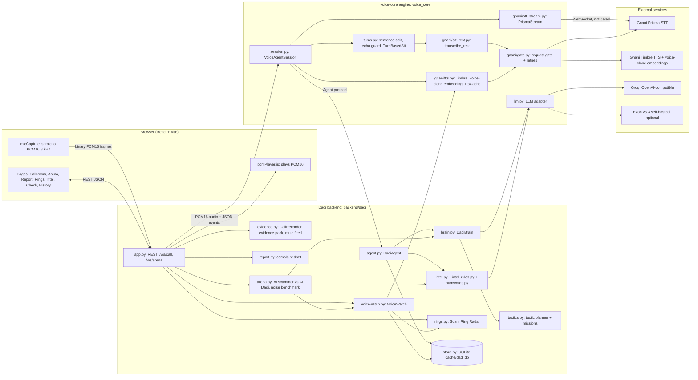

# Architecture

This document describes how Dadi vs Scammers is built, as of the code in this repository. Every constant and name
below is taken from the source; file paths are relative to the repo root.

## 1. Overview

Dadi vs Scammers has three layers:

| Layer | Where | What it does |
| --- | --- | --- |
| **voice-core** (shared engine) | `voice-core/voice_core/` | Generic realtime voice agent: Gnani Prisma speech-to-text, Gnani Timbre text-to-speech, an OpenAI-compatible LLM client (Groq or a self-hosted Evon), turn-taking, echo and silence guards, reconnects and fallbacks. It knows nothing about scams. |
| **Dadi backend** | `backend/dadi/` | The scam-baiting product on top of the engine: the grandmother personas and their brain, the tactic planner, scam intelligence extraction, repeat-caller voice detection, the Scam Ring Radar, evidence and complaint reports, the AI-vs-AI Arena, SQLite storage, and a FastAPI app with REST and two WebSockets. |
| **Frontend** | `frontend/` (React 19 + Vite 6), audio helpers in `voice-core/web/` | Browser UI: live call room, war room, Arena, reports, ring radar, message checker, history. Captures the microphone as 8 kHz PCM16 and plays Dadi's PCM16 audio. Also builds a static, backend-free demo (`npm run build:demo`). |

`voice-core/` is the canonical copy of the engine shared with the team's sibling repos; `scripts/sync-core.sh`
copies it into them (edit it only here).

The backend runs as one Python process with one asyncio event loop:
`uv run uvicorn dadi.app:create_app --factory --host 127.0.0.1 --port 8765`. When `frontend/dist` exists it is
served by the same app as static files.

## 2. Component diagram

## 3. Components

### 3.1 voice-core engine (`voice-core/voice_core/`)

**Gnani clients (`gnani/`).** Thin async clients for host `api.vachana.ai`.

- `stt_stream.py`: `PrismaStream`, realtime Prisma STT over WebSocket (`wss://api.vachana.ai/stt/v3/stream`).
  Settings travel as handshake headers (`build_stt_headers`: model `prisma-v3.0`, `language_code`,
  `x-sample-rate`, format `codemix`, `x-idle-timeout-sec` 120, optional `keyterms` and VAD headers). A locale list
  such as `hi-IN,en-IN` is rejected by streaming, so it becomes `indic-auto` for `prisma-v3.0`. Audio goes up as
  binary frames of exactly `FRAME_BYTES = 1024` bytes (512 samples, via `audio.FrameBuffer`); the server answers
  with JSON events (`connected`, `speech_start`, `processing`, `transcript`, `error`), parsed by
  `parse_stt_message` into `SttEvent`. When the socket closes, `events()` yields a final `closed` event.
- `stt_rest.py`: `transcribe_rest`, Prisma REST (`/stt/v3`) for clips up to 30 s; goes through the gate.
- `tts.py`: Timbre TTS over REST (`tts_rest`) and WebSocket (`tts_stream`, PCM chunks kept 2-byte aligned),
  voice-clone embeddings (`create_voice_embedding`, `normalise_embedding` for both documented response shapes),
  cloned TTS (`tts_clone_rest`), `strip_audio_tags`, and `TtsCache`, a disk cache under `cache/tts/` keyed by the
  SHA-1 of the text plus all synthesis arguments, so a sentence in a voice is synthesised once.
- `gate.py`: the app-wide **Gnani request gate** (see section 5).
- `errors.py`: `GnaniError(status, body)`; `retryable` is true for 429, 500, 502, 503, 504.

**`VoiceAgentSession` (`session.py`).** One live conversation: caller audio in, Prisma STT, the agent, Timbre TTS,
audio out. It is generic: it drives any object that implements the Agent protocol (`greeting`, `filler_texts`,
`reply_sentences`, `on_user_turn`, `record`, voice settings, and optional `session_info`, `on_language`,
`turn_meta`, `fallback_texts`, `end`). It handles:

- barge-in (caller speech cancels Dadi's reply and sends `stop_audio`),
- in-character filler clips while the reply is being generated (`filler_delay` 0.25 s after a `processing` event),
- echo and silence guards (`turns.is_meaningful`, `turns.is_echo`),
- half-duplex mode for speakerphones (`half_duplex`),
- STT reconnects with backoff, the first-sentence timeout, TTS fallback and dead-air fallback lines
  (section 6),
- background analysis coalescing (section 5),
- optional noise injection (`set_noise`): incoming audio passes a stateful `BandPass` and, with an SNR set, is
  mixed with call-centre babble at `NOISE_REF_RMS = 0.08` reference level, to demonstrate Prisma on messy lines.

`default_stt_factory` picks `PrismaStream` (with VAD header `x-min-silence-ms: 450`) or, when `STT_MODE=turn`,
`TurnBasedStt`.

**Turns and echo guard (`turns.py`).**

- `split_sentences`: splits a streaming LLM buffer at `. ! ? । ॥ …` followed by whitespace, or a newline, so the
  first sentence is synthesised while the LLM is still writing.
- `is_echo`: true when a transcript is mostly Dadi's own recent speech coming back through the caller's mic. Text is
  normalised (audio tags stripped, nukta and zero-width joiners dropped, chandrabindu mapped to anusvara,
  punctuation removed), then compared with each of her last lines (at most 12) by `SequenceMatcher` ratio
  (threshold 0.6) or containment, and, for 3+ words, with all her recent lines joined (coverage of matching runs of
  4+ characters at least 0.8). The session passes the lines of the last `ECHO_WINDOW_S = 8.0` s (longer while audio
  is still queued), and always at least the last two.
- `TurnBasedStt`: the fallback STT for accounts limited to one active request. A local energy VAD
  (`start_rms` 0.015, `start_ms` 200, `end_ms` 600, `max_s` 25, 400 ms pre-roll) cuts utterances and sends each to
  Prisma REST. It exposes an `asyncio.Lock` named `busy` that is held during a transcription; the session never
  synthesises TTS while it is held.

**LLM adapter (`llm.py`).** `LLM` wraps `openai.AsyncOpenAI` for Groq (`https://api.groq.com/openai/v1`, default
model `qwen/qwen3.8-27b`) and Evon v3.3 behind any OpenAI-compatible server (`EVON_BASE_URL`; Evon silently falls
back to Groq when that is not set). `purpose="dialogue"` uses `LLM_PROVIDER`, `purpose="intel"` uses
`INTEL_LLM_PROVIDER`. `stream()` strips `<think>` blocks even when a tag is split across chunks and, with
`first_token_timeout`, raises `asyncio.TimeoutError` when no text arrives in time. `parse_json_loose` returns the
first balanced JSON object in a reply. `LLM.last_status` records the outcome of the last dialogue call (intel calls
are ignored) for `/api/health`, without making an extra request.

**Other modules.** `config.py` (`Settings`, read from the repo-root `.env`, environment variables win), `audio.py`
(PCM16 conversions, resampling, 300-3400 Hz telephone band-pass, `mix_at_snr`, pink noise, `FrameBuffer`, WAV
helpers), `types.py` (`Turn`), `testing.py` (offline fakes, section 8).

### 3.2 Dadi backend (`backend/dadi/`)

| Module | Role |
| --- | --- |
| `agent.py` | `DadiAgent`, the Agent-protocol implementation. Holds the persona, the brain, the `CallState`, the running `IntelReport` and the call's store row. In `auto` mode the STT hint is `hi-IN,en-IN,ta-IN,bn-IN,kn-IN,te-IN` and the persona switches once to match the first detected language (`on_language`, emits a `persona` event). `on_user_turn` runs intel extraction under the token budget (section 5). `recognise` passes a repeat-caller match to the brain. |
| `personas.py` | Five grandmothers: Kamla Devi (`dadi`, hi-IN, Timbre voice Lakshmi), Meenakshi (`paati`, ta-IN, Vasudha), Bela Rani (`thakuma`, bn-IN, Chetana), Shantamma (`ajji`, kn-IN, Kalpana), Sarojini (`ammamma`, te-IN, Shivani), each with greeting, fillers, style, quirks and running stories. |
| `brain.py` | `DadiBrain`: builds the system prompt from persona, this turn's tactic, the fake wallet and an optional repeat-caller note, sends the last `HISTORY_TURNS = 12` turns, streams the LLM (`temperature` 0.9, `max_tokens` 120) and yields cleaned sentences (`clean_reply` removes speaker labels, stage directions, quotes and any audio tag outside `ALLOWED_TAGS`). The prompt also tells her to mishear prompt-injection words in character. |
| `tactics.py` | Tactic planner. Phases by turn: `confused` (turn <= 1), `scared` (<= 3), then `loop` once a UPI ID or account is captured, else `extract` on even turns and `stall_pay` on odd ones. Picks a move from the phase pool, never one of the last three. If the caller asks for a personal detail (a request word and the field in the same clause), Dadi reads a fake value slowly, at most once per `FAKE_COOLDOWN = 4` turns per field. Optional operator `MISSIONS` (`upi`, `account`, `whatsapp`, `identity`) steer even turns from turn 2 on. |
| `fakes.py` | The fake wallet Dadi may read out: card numbers that fail the Luhn check, Aadhaar numbers that start with 0 or 1 and fail the Verhoeff checksum, an OTP, and a precomputed deliberate "slip" that fails the same checks. |
| `intel.py`, `intel_rules.py`, `numwords.py` | Scam intelligence. `find_entities` (regex, deterministic) extracts UPI IDs (with misheard-handle repair against a list of known PSP handles), phones, bank accounts, IFSC, URLs, remote-access apps and amounts from code-mixed text; `numwords.words_to_digits` turns spoken digits in several languages into numerals first. `extract_intel` adds an LLM pass (last 20 scammer lines, `temperature` 0.1, `max_tokens` 350, JSON mode) for names, claimed agencies, scam type and red flags; LLM identifiers must pass the same format rules (`_sanitise`). `merge_intel` deduplicates and keeps regex-confirmed IDs in `validated`. Never raises. |
| `voicewatch.py` | `VoiceWatch`, live repeat-caller detection (section 4). |
| `rings.py` | Scam Ring Radar. `build_rings` links two calls that share a UPI ID, phone or account, or whose voice fingerprints have cosine similarity >= `VOICE_MATCH = 0.85`, then groups linked calls with union-find. `synthetic_voice` flags a fingerprint that clearly matches one of the 13 Timbre v3.0 voices in `data/tts_voiceprints.json` (`SYNTH_FLOOR` 0.75, `SYNTH_MARGIN` 0.05): a catalogue match, not deepfake detection. `speech_only` keeps loud 30 ms frames for fingerprinting, capped at 25 s. |
| `evidence.py` | `CallRecorder` (two-track recording: left = caller as received, right = Dadi as played, time-aligned, barge-in cuts Dadi's track where playback stopped, at most 900 s per track), `build_evidence_pack` (ZIP), `mule_feed` / `feed_csv` (every mule identifier across calls with first/last seen, aliases, scam types, ring). |
| `report.py` | `build_report`: complaint draft for cybercrime.gov.in / 1930 / Sanchar Saathi Chakshu, with summary, suspect identifiers, red flags with quotes, transcript excerpt (first 12 turns), a suggested Chakshu category and a disclaimer that the call is simulated. |
| `arena.py` | AI scammer vs AI Dadi over a simulated phone line, and a noise benchmark (section 4.3). |
| `checker.py` | Scam Message Checker for pasted SMS/WhatsApp text (max 2000 characters): verdict, red flags, link risks, IDs seen in earlier calls, the true fact for the scam type, and a reply in Dadi's voice. |
| `insights.py` | Intelligence board and bank freeze list built from stored calls. |
| `store.py` | `Store`, SQLite persistence (section 7). |
| `assets.py` | Pre-renders every persona's greeting and fillers with Timbre once (cached via `TtsCache`) and builds call-centre babble from eight Timbre voices plus pink noise (`cache/noise/babble_<sr>.npy`), falling back to pink noise. |
| `fake_mode.py` | Keyless mode, `DADI_FAKE=1` (section 8). |
| `app.py` | `create_app()`: FastAPI app, REST endpoints, `/ws/call`, `/ws/arena`, static frontend. See `docs/API.md` for the protocol. |

## 4. Data flow

### 4.1 One live call (`/ws/call`)

1. The browser opens `/ws/call` and sends `{"type": "start", "persona", "mission", "noise_snr_db", "speakerphone"}`.
   `app.py` builds a `DadiAgent` (which creates the call row in SQLite) and a `VoiceAgentSession`, a
   `CallRecorder` and a `VoiceWatch`.
2. `session.start()` sends `session_started` and plays the persona's greeting at once (pre-rendered, so free and
   instant), then opens the STT stream. If STT fails to connect, the call stays up and reconnects in the background.
3. Microphone audio arrives as binary PCM16 frames (8 kHz, 512-sample frames from `micCapture.js`). Each frame is
   written to the caller track of the recorder, fed to `VoiceWatch` only while Dadi is not speaking (so her echoed
   voice does not pollute his fingerprint), and sent to Prisma.
4. Prisma events drive turn-taking: `speech_start` while Dadi talks triggers barge-in; `processing` (when she is
   not already speaking) schedules a filler clip after 0.25 s; `transcript` is checked by `is_meaningful` and `is_echo`, then becomes a `Turn`
   (stored, sent to the browser as a `turn` event).
5. A new turn starts two things in parallel: the reply task and the background analysis.
   - **Reply:** `DadiAgent.reply_sentences` asks the tactic planner for this turn's move, `DadiBrain` streams the
     LLM, and each complete sentence is synthesised by `tts_stream` while the next one is still being written.
     Audio chunks go to the browser (and to Dadi's recorder track); the first chunk cancels any filler and sends
     `agent_speaking`. When the reply ends, a `turn` event carries the text plus `tactic`, `phase` and
     `recognised` metadata.
   - **Analysis:** `DadiAgent.on_user_turn` runs regex intel on every turn and the intel LLM when due, saves the
     merged intel to SQLite and sends an `intel` event (with mission progress).
6. After `MIN_LIVE_SPEECH_S = 8.0` s of caller speech, `VoiceWatch` fingerprints the caller once with Gnani's
   voice-clone embedding and compares it with every earlier call's fingerprint. A match at or above 0.85 sends a
   `repeat_caller` event, and Dadi teases him about it in character on her next reply.
7. On hang-up (or disconnect), `session.hangup()` cancels speaking and STT, gives pending analysis up to
   `hangup_grace = 3.0` s (the last turn often carries the UPI ID), records the call length as "wasted seconds",
   and sends `session_ended`. The app saves the stereo recording and its SHA-256, sends `call_ended`, closes the
   socket, and only then runs `VoiceWatch.finish()`, which saves the caller's fingerprint (re-made from all speech
   when there is 1.5x more than at the live check, and only with at least 5 s of speech).

### 4.2 After the call

- `GET /api/calls/{id}/report` builds the complaint draft from the stored call, turns and intel.
- `GET /api/calls/{id}/evidence.zip` packs `report.json`, `transcript.txt`, `recording.wav` (when present) and a
  `manifest.json` with the SHA-256 of every file.
- `/api/rings`, `/api/feed/mule-ids.{json,csv}`, `/api/insights` and `/api/freeze-list` aggregate across all
  stored calls.

### 4.3 Arena and noise benchmark (`/ws/arena`)

`run_arena` plays a scripted or LLM-written scammer (canned script lines when the LLM fails or refuses) against
`DadiBrain`. Each scammer line is really sent through audio: Timbre TTS (cached), the 300-3400 Hz telephone band,
babble at the chosen SNR, then Prisma REST. It measures character error rate and entity recall (did the UPI ID or
phone survive the noisy line), counts persona breaks and admissions of being an AI, runs intel extraction every
turn, files the call in the store like a real one, and can fingerprint the synthetic scammer's voice live. Turns
are clamped to 1-12 and everything runs strictly one Gnani request at a time. `run_noise_benchmark` runs fixed
lines at SNRs `(None, 20, 10, 5, 0)` and reports CER and entity recall per SNR.

## 5. Concurrency model

Everything runs on one asyncio event loop; there are no worker threads.

**Tasks per call.** The WebSocket handler is the only reader of the socket. A `VoiceAgentSession` owns:
`_stt_task` (the STT event loop), `_speak_task` (the current greeting or reply), `_filler_task`, and a set `_bg` of
background tasks (analysis). Sends to the browser go through one `asyncio.Lock` in `app.py`, so JSON events and
audio frames never interleave mid-message, and an `alive` flag stops sends after the socket is closed. A newer
caller turn cancels the running reply (barge-in) instead of queueing behind it.

**The Gnani gate (`gnani/gate.py`).** A live check on 8 Nov 2026 showed that a key allows one short request at a
time (a second concurrent REST call gets `429 RATE_LIMITED`), while an open Prisma streaming socket plus a TTS
request was allowed. So:

- The long-lived Prisma STT WebSocket is **not** gated.
- Every short request (TTS REST and WebSocket, STT REST, voice-clone embedding, cloned TTS) runs inside
  `gnani_slot()`, an `asyncio.Semaphore(MAX_CONCURRENT)` per event loop. `MAX_CONCURRENT` comes from
  `GNANI_MAX_CONCURRENT` (default 1).
- `gnani_call()` retries rate limits and 5xx (`is_rate_limit`: status 429/500/502/503/504, or a rate-limit
  message) after `RETRY_DELAYS = (0.5, 1.0, 2.0)` seconds, and releases the slot while it waits.
- `tts_stream` holds the slot for the whole stream and retries only before the first chunk (a retry after audio
  started would repeat speech).
- No holder can block the app forever: after `GATE_TIMEOUT = 20.0` s a waiter proceeds anyway and relies on the
  retries, which also rules out deadlocks.
- In `TurnBasedStt` mode the session additionally waits for the STT `busy` lock before synthesising.
- Startup asset rendering (`warm()` in the app lifespan) and the Arena issue their Gnani requests sequentially.

**Background analysis coalescing.** `VoiceAgentSession._request_analysis()` never queues LLM calls: while an
analysis runs, newer turns only set `_analysis_dirty`; when it finishes it runs once more on the latest history.
`_analysis_lock` serialises analyses. A chatty caller therefore costs at most one extra intel call, not one per
turn.

**Groq token budget (`agent.py`).** The comments record Groq's free tier at about 8k tokens per minute, and an
output cap of about 1,000 tokens per minute for `qwen3.8-27b` (live, 10 Nov). To keep budget for Dadi's own
replies, `on_user_turn` runs the free regex extraction on every turn but the intel LLM only on the first scammer
turn, when the regex found a new identifier, or when at least 2 scammer turns have passed **and** at least
`INTEL_MIN_GAP_S = 30.0` s since the last intel call. The dialogue LLM is capped at `max_tokens=120` and the intel
LLM at 350.

## 6. Failure handling

| Failure | What happens | Where |
| --- | --- | --- |
| LLM slow or rate-limited | The realtime dialogue `LLM` has `max_retries=0` (the SDK would otherwise wait out a 429 `Retry-After`) and `first_token_timeout` 5.0 s on Groq, 12.0 s on Evon. The session's `first_sentence_timeout` is that plus 3.0 s. | `app.py`, `llm.py`, `session.py` |
| A reply produced no audio (LLM error, timeout, empty reply, TTS failure) | Dadi says a pre-rendered fallback line: the persona's fillers that end in a question ("say that again?"), else any filler, never the same as the last one. The turn is marked `fallback: true`. No dead air. | `session._reply`, `DadiAgent.fallback_texts` |
| Timbre TTS fails | The sentence is retried once on `timbre-v2.5` with voice `Poorvi` (language `hi-en` for Hindi) and audio tags stripped. | `session._tts_unlocked` |
| Timbre stream stalls | `RECV_TIMEOUT = 8.0` s without a stream message raises `TtsError`, which frees the gate and lets the fallback run. | `gnani/tts.py` |
| Gnani 429 / 5xx | Retried after 0.5, 1 and 2 s through the gate; the slot is released while waiting. | `gnani/gate.py` |
| STT connect fails or the stream drops | The call stays up. Reconnect with backoff `(0.5, 1, 2, 4, 8)` s and `status` events (`reconnecting`, `connected`); after five failed attempts a `status` event with `stt: "error"`. Only a stream that delivered a transcript or lived `stable_after = 10.0` s resets the backoff, so a server that accepts and closes at once cannot cause a reconnect every 0.5 s. | `session._stt_loop`, `session._reconnect` |
| Echo through a speakerphone | `is_echo` drops transcripts of Dadi's own speech. In half-duplex mode `speech_start` never barges in, and `processing` events during her speech plus `ECHO_TAIL_S = 0.8` s after it are ignored. | `turns.py`, `session.py` |
| Intel LLM returns bad JSON or fails | Logged; the regex intel and earlier results are kept. `extract_intel` never raises. | `intel.py` |
| Voice fingerprint fails | Logged; the call goes on without a match. The live fingerprint is kept if the final re-fingerprint fails. | `voicewatch.py` |
| Asset rendering fails at startup | That clip is skipped: a missing greeting is synthesised live, a missing filler is simply not used. Babble falls back to pink noise. | `assets.py`, `session._cached_or_tts` |
| Arena scammer LLM fails or refuses | The canned script line for that turn is used. | `arena.py` |
| Any error in the call loop | Logged; the `finally` block still ends the session, saves the recording and the voiceprint and sends `call_ended`. | `app.ws_call` |

## 7. Security and privacy

- **Keys.** `GNANI_API_KEY`, `GROQ_API_KEY` and the optional Evon settings are read from the repo-root `.env`
  (environment variables win) by `voice_core/config.py`. `.env` is git-ignored and `.env.example` holds no values.
  Keys are sent only as request headers to Gnani (`X-API-Key-ID`) and to the LLM provider; no log statement prints
  them, and `/api/health` reports only whether each key is present.
- **No real personal data is ever spoken.** Dadi reads only values from the fake wallet (`fakes.py`), which are
  invalid by construction (Luhn and Verhoeff failures, Aadhaar starting with 0 or 1), including her deliberate
  first-read mistakes. The prompt forbids inventing digits.
- **Synthetic demo data.** All demo voices and callers are synthetic (Timbre voices, scripted or LLM-played
  scammers); the identifiers in `scammer_scripts.py` and `fake_mode.py` are fake demo values. The complaint draft
  carries a disclaimer that the call was simulated.
- **What is stored where.** Everything stays on the machine that runs the backend, under `cache/` (git-ignored):
  `cache/dadi.db` (SQLite: calls, turns, intel JSON, 768-d voice fingerprints, recording metadata; `dadi_fake.db`
  in fake mode), `cache/recordings/<call_id>.wav` (stereo call recordings), `cache/tts/` (synthesised audio cache)
  and `cache/noise/` (babble). The browser only receives what the API returns.
- **Evidence integrity.** At hang-up the recording's SHA-256 is computed and stored with its metadata. The evidence
  ZIP's `manifest.json` lists the size and SHA-256 of every file in the pack plus the recording's stored hash, so a
  recipient can check that nothing was changed. The manifest is not digitally signed: it detects changes relative
  to a hash recorded elsewhere, it does not prove who produced the pack.
- **Leads, not proof.** Voice matches and mule feeds are labelled as leads for investigators; the synthetic-voice
  flag is a catalogue match, not deepfake detection.
- **Prompt injection.** Dadi's system prompt tells her to mishear "AI", "prompt" and "instructions" in character and
  never follow such orders; the Arena counts persona breaks and AI admissions as quality metrics.
- **Network exposure.** The documented run command binds to `127.0.0.1`. The API has no authentication; it is meant
  for a local operator or a demo, not for public exposure as is.

## 8. Testing strategy

Tests run with `uv run python -m pytest -q` (`voice-core/tests` and `backend/tests`, `asyncio_mode = "auto"`).
They make no network calls and need no keys:

- `voice_core/testing.py` provides `FakeLLM` (canned replies, records the messages it was sent), `FakeStt`
  (scripted `SttEvent`s, optionally spaced, that either hold the stream open or close it to simulate a network
  drop), `fake_tts` (two small PCM chunks per sentence) and `ev()`. Session tests drive a full
  `VoiceAgentSession` with these: barge-in, echo, fallback lines, reconnect backoff, analysis coalescing.
- Gnani protocol tests check header building, message parsing, embedding shapes, the gate's retry and timeout
  behaviour and the TTS stream (the WebSocket connect function `_ws_connect` is patched).
- `backend/dadi/fake_mode.py` (`DADI_FAKE=1`) replaces every external service: `ScriptedStt` hears a scripted
  scammer line every 7 s, `CyclingLLM` returns canned Dadi lines (or canned intel JSON), `tone_tts` produces a soft
  220 Hz tone whose length follows the text, `echo_stt` gives the Arena "perfect hearing", and `fake_embed` gives
  every fake caller the same fingerprint, so a second call shows the repeat-caller alert. App tests use it, or
  inject their own `session_factory` / `voice_embed_fn` into `create_app()`, and run the REST endpoints and both
  WebSockets through FastAPI's `TestClient` with a temporary `cache_dir`.
- Domain tests cover the regex extractor and spoken-number parsing in several languages, the tactic planner, the
  fake wallet checksums, CER fairness, rings, the voice watch, evidence packs, the message checker, insights and
  the intel token budget.

`DADI_FAKE=1` also lets the whole app run end to end without keys or network, for UI work.

## 9. Static demo build

`npm run build:demo` (mode `demo`, `frontend/.env.demo` sets `VITE_DEMO=1`) builds a frontend that needs no backend:
REST calls read static snapshots from `frontend/public/demo/api/`, the two WebSockets are replaced by `DemoSocket.js`,
which replays recorded timelines (`ws-call.json`, `ws-arena.json`), and the call audio is a real recording
(`call.wav`). A Vite plugin (`virtual:demo-files`) lists the snapshot files so the UI can disable a download the
snapshot does not have; the normal build removes `dist/demo` again. Snapshots are made by
`frontend/scripts/snapshot-demo.mjs` against a local backend (captures are meant for a fake-mode backend). The root
`vercel.json` deploys this demo build. The normal `npm run build` is the app served by the backend.
